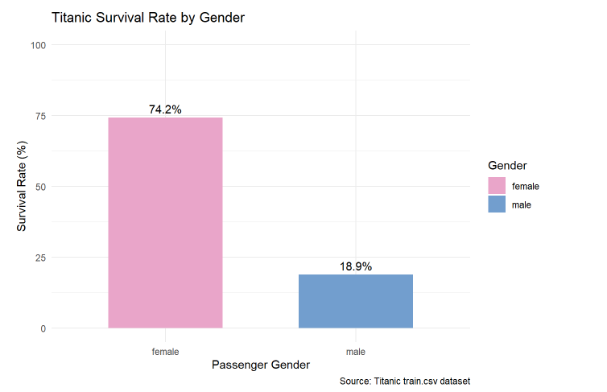
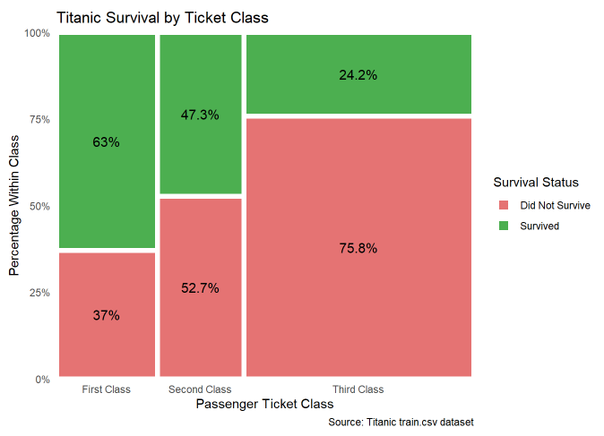
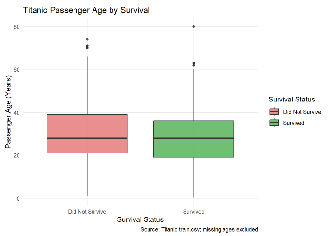

# Titanic Survival Analysis Using R

## View the Full Analysis Report

[View Live Titanic Survival Analysis Report](https://mariagarciaaaa.github.io/titanic-survival-analysis-r/)

Explore all three analyses, including the R code, statistical results, and visualizations.

## Project Overview
This project explores Titanic passenger survival patterns
using R to investigate how gender, passenger ticket class,
and age relate to survival outcomes.

The analysis uses a dataset containing 891 passenger records.

## Research Questions
1. Were female passengers more likely to survive than male passengers?
2. Was passenger ticket class associated with survival rates?
3. Did passenger ages differ between survivors and non-survivors?

## Tools and Technologies
- R
- RStudio
- tidyverse
- dplyr
- ggplot2
- Exploratory Data Analysis (EDA)
- Chi-square statistical tests
- Data visualization

## Key Findings

### Analysis 1: Gender and Survival
- Female passengers: 74.2% survival rate
- Male passengers: 18.9% survival rate
- A chi-square test found a statistically significant
  association between gender and survival (p < 0.001).

### Analysis 2: Ticket Class and Survival
- First Class: 63.0% survival rate
- Second Class: 47.3% survival rate
- Third Class: 24.2% survival rate
- A chi-square test found a statistically significant
  association between ticket class and survival (p < 0.001).

### Analysis 3: Age and Survival
- Average survivor age: approximately 28.3 years
- Average non-survivor age: approximately 30.6 years
- Both groups had a median age of 28 years.
- Missing ages were excluded from this analysis.

## Visualizations

### Analysis 1: Gender and Survival

Female passengers had a survival rate of 74.2%, compared with 18.9% for male passengers.

### Analysis 2: Ticket Class and Survival

Survival rates decreased from 63.0% in first class to 24.2% in third class.

### Analysis 3: Age and Survival

Survivors were approximately 28.3 years old on average, compared with 30.6 years for non-survivors.

## Project Structure

## Project Structure
- [R Analysis Script](code/Titanic_MG.R) — Complete R code script for all three analyses
- [HTML Report](code/Titanic_MG.html) — Compiled HTML analysis report
- [Titanic Dataset](data/train.csv) — Titanic passenger dataset

## How to Run
1. Open the repository folder as the working directory in RStudio.
2. Install the `tidyverse` and `here` packages if needed.
3. Run `code/Titanic_MG.R`.
4. Open `code/Titanic_MG.html` to view the complete report.

## Limitations
The dataset contains 891 passenger records and does not
represent everyone aboard the Titanic.

The age analysis excludes 177 passengers with missing age
information.

Statistical associations do not establish direct causation.
